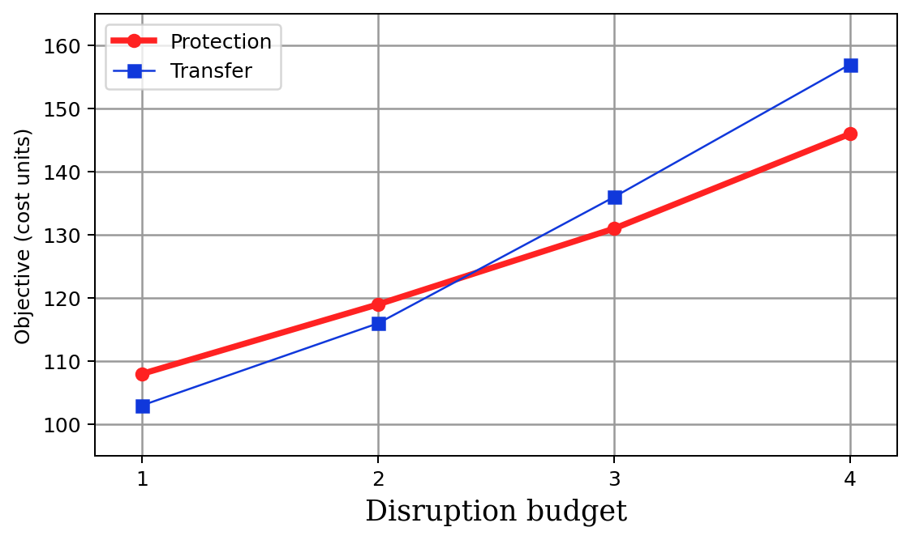
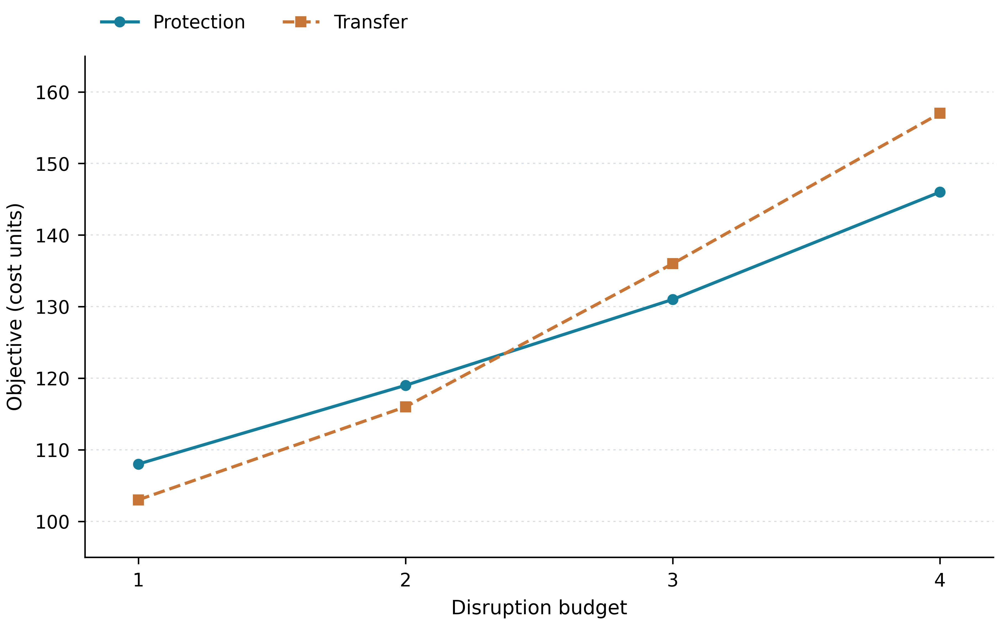

# 科研绘图辅助｜从重复调图到可复用工作流

个人 AI 产品实践 · 版本 1.2 · Python / Matplotlib · 可调用 Skill

[发现痛点](docs/Requirements.md) → [定义需求与 PRD](docs/PRD.md) → [Skill 实现](docs/Implementation.md) → [案例对比](docs/Examples.md) → [复盘迭代](docs/Retrospective.md)

## 一、问题与需求

科研图表分散在不同脚本中，配色、字体和图例难以统一；实验数据更新后，还要重新调图与核对数值。基于个人科研中的重复反馈，我将问题转成三个需求：样式统一、更新可复现、输出可核对，并用 PRD 确定首版范围和验收标准。

## 二、方案与调用

以 Skill 组织选图与核对流程，以共享 Python 样式和绘图脚本执行，输出 600 DPI PNG、矢量 PDF / SVG 及实际绘图表。首版优先打通 CSV 到图表的完整流程，Excel 与日志先转换为统一字段。需求、代码与验收的对应见 [实现说明](docs/Implementation.md)。

将解压后的完整文件夹放入你的项目目录 `.agents/skills/`，使路径为 `.agents/skills/research-figure-assistant/SKILL.md`。在该项目中启动 Codex CLI 或 IDE 扩展，使用 `/skills` 确认已识别，再输入下面的调用语句；未出现时重新启动。其他宿主按其自定义技能方式导入。

安装与调用依据：[OpenAI 官方说明](https://learn.chatgpt.com/docs/build-skills)（核对日期：2026-10-21）。这里提供本地技能目录，插件分发属于后续版本。

```text
请使用 $research-figure-assistant，读取 examples/comparison.csv。
比较两种策略随 budget 变化的 objective，纵轴单位为演示成本单位。
按统一风格绘制，导出 PNG、PDF、SVG，并保留实际绘图数据。
```

提供自己的文件时，替换输入路径并说明字段、单位和比较目标。只想先看效果，在本项目根目录运行：

```bash
python -m pip install -r assets/requirements.txt
python examples/compare.py
```

## 三、效果与复盘

同一份八条演示记录生成了下方两图：数值与坐标范围相同，统一后调整配色、字体、线型与图例，并可由脚本重新导出。已有六类绘图入口通过样例运行；当前证据支持复现与格式输出，工时收益待实际任务记录。下一轮重点观察数据更新后的返工原因，详见 [复盘](docs/Retrospective.md)。

| 临时设置示例 | 应用统一规范 |
| --- | --- |
|  |  |

两图均使用人工构造数据。查看 [复现过程与证据](docs/Examples.md) · [验证记录](docs/Validation.md) · [参考来源](references/sources.md) · [许可](LICENSE)。
